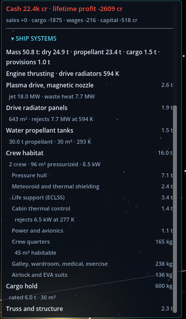
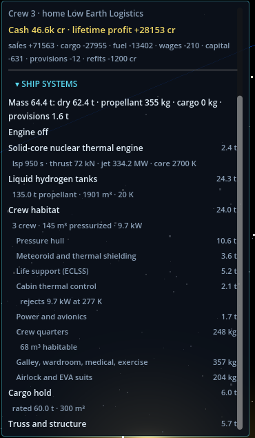
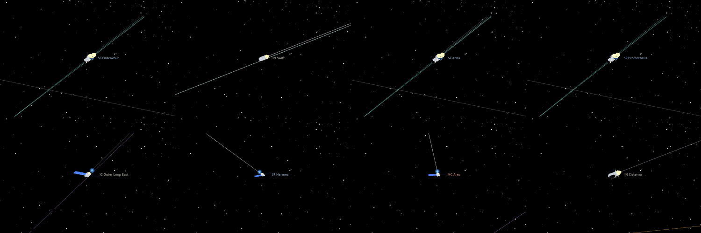
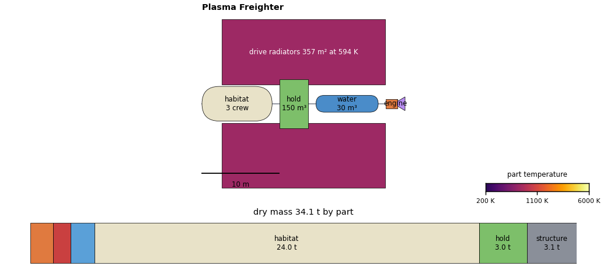
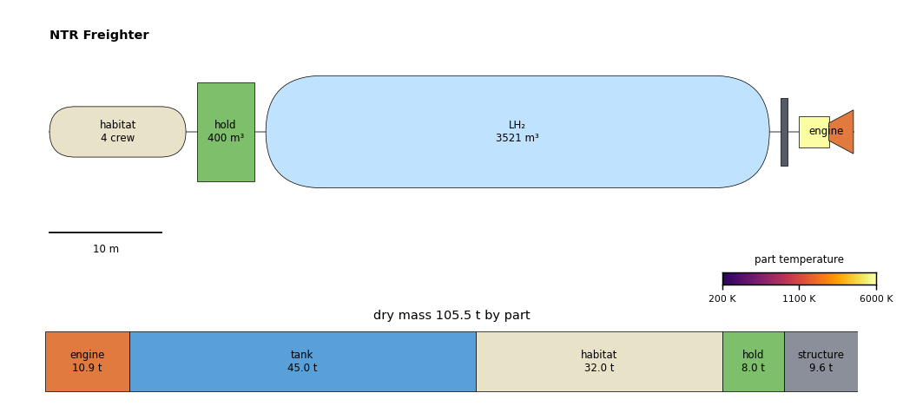
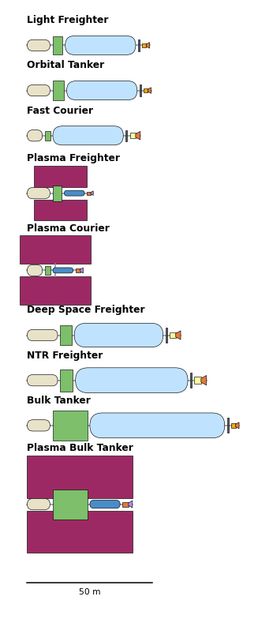

# Ship Structure Visuals: Proposal for Review

Status: proposal (2026-10-11). Nothing here is built except the evidence: screenshots, and to-scale mockups
generated from the real component data by `tools/ship_schematic_mockup.py`.

Goal: make the ship structures from tier 1 (`ship_internals.md`) visible, so a player sees at a glance:
- what a ship is made of;
- why a plasma ship has huge radiators and a thermal ship a huge hydrogen tank;
- what changes when the ship refits, or a part is damaged (tier 2).

## What Exists Now

### The ship systems section (tier 1, text)

| Plasma Courier | Light Freighter (tank variant) |
|---|---|
|  |  |

All the numbers are there, but as a list: it is long (it needs scrolling) and the proportions don't show.

### The 3D models, at the closest zoom the camera allows

Findings from the screenshots (ShotTour now has a `ship_model_<hull>` stop, taken paused, with
`--shot-no-glow`):
1. **Models are 30-60 px at most.** `OrbitCamera.gd:59` clamps the near plane to ≥ 0.0002 world units. A ship
   model (display-scaled to about 2·10⁻⁵ units) is therefore clipped at any closer zoom. A ship can't be looked at
   closely in the map.
2. **Models depend only on drive and three hard-coded class ids** (`EntityVisuals.gd`).
   - The thermal freighters are hard to tell apart.
   - Every plasma ship is the same bus with two blue wings, whether a 10 MW freighter or a 40 MW bulk tanker.
   - Since today, models follow `hull_id`; before, tank variants fell back to the default model.
3. **Engine glow** is the brightest thing on screen at close range; it hides the model.

So the map is the wrong place for detail. The detail should go into a view made for it, and the map can then
reuse the same shapes in simplified form.

## Proposal A (recommended first): to-scale schematic in the inspector

A `ShipSchematic` Control (GDScript `_draw()`) replaces the top of the text list. The list stays below it,
collapsed by default.

Layout rules, all from the `.designs` data, with nothing hand-drawn per class:

| Part | Shape | Size from |
|---|---|---|
| Habitat | rounded cylinder, 4.5 m across (DSH module) | pressurized volume |
| Hold | box | volume (1 m³ per unit) |
| Tanks | rounded cylinder | propellant volume: LH2 is 14× bulkier than water, which is the visual story of the two drives |
| Shadow shield | thin plate (thermal ships) | fixed |
| Engine | reactor block plus nozzle (thermal) or drive plus magnetic nozzle (plasma) | engine mass |
| Radiators | two wings, 2.5:1 | panel area (357 m² Plasma Freighter, 1,429 m² Plasma Bulk Tanker) |
| Truss | line along the axis | — |

Live overlays, from snapshot fields that already exist:
- **Tank fill:** the tank fills to `propellant_kg / capacity`. **Hold fill:** to `cargo_units / capacity`, coloured by
  commodity.
- **Temperature, in false colour (inferno scale, legend in the corner):**
  - radiators by `radiator_temperature_k` (594 K thrusting, ~200-500 K idle);
  - the reactor block by core temperature while `engine_state == burning`.
  - Physical note: visible glow starts near 800 K (the Draper point). 594 K radiators would look dark to the eye,
    so the colour is a thermal view, not a photo. LH2 tanks get a frost-white tint at 20 K.
- **Engine:** a plume when burning or thrusting.
- **Crew:** a dot per berth in the habitat.
- **Hover:** a part shows its spec line (the current text) as a tooltip, and the part highlights in the mass bar.

Below it, a **stacked mass bar** shows the current mass: the dry parts, then propellant, cargo and provisions. It
makes the rocket equation tangible: a full NTR Freighter is 70% propellant.

Tier 2 fits naturally:
- modules are extra blocks (common room, hydroponics bay, storm shelter, cryo bay);
- damaged parts are hatched red, with a condition bar;
- a refit preview draws the before and after side by side.

Effort: about a day, including a scale bar, a theme pass and a ShotTour stop. Risk: low; it is a 2D widget with
no simulation change.

## Proposal B: fleet at one scale ("Shipyard" panel)

Every hull at one scale, with Δv (laden and empty), α/κ, crew, hold, price and the number in service. It opens
from the market panel or a key (Y).

What it shows:
- the design space the economy chooses from: why fleet investment bought a Plasma Bulk Tanker, why Ganymede ships
  are plasma;
- the tank variants as ghosted outlines.

In tier 2 it becomes the refit and module browser.

Effort: half a day after A, reusing the A widget per row.

## Proposal C: a ship close-up viewer (3D, built from components)

Instead of fighting the map's scale and near plane, render the selected ship in its own small SubViewport in the
inspector:
- a turntable with its own camera and lighting, metre scale and no world precision issues;
- an "expand" button for a larger view.

`EntityVisuals` builds the model from the design components with the same layout rules as A (cylinders,
boxes, wings and nozzle sized by volume and area), so the map model and the close-up agree.

Live state:
- radiator emission by temperature;
- tank frost;
- the reactor glow when burning;
- the plume.

The map keeps the current tiny models, now generated the same way, so a bulk tanker looks like one even at
40 px.

Effort: 1-1.5 days. Worth it after A, because A answers "what is this ship made of" faster and more clearly.

## Proposal D (small, optional): map hints
- Radiator wings on the map icon glow (false colour) while thrusting.
- Engine glow sized by jet power: 10 MW plasma vs 700 MW liquid core, roughly log-scaled.
- Thermal ships' glow follows the bridge's `engine_state` (burn length from propellant and mass flow) instead
  of the fixed `BURN_WINDOW_S` in `EntityVisuals.update_engine_glow`.

Effort: a couple of hours.

## Recommended order
1. A: the schematic, mass bar and live overlays.
2. Tier 2 core (designs derived in C++, modules) can start meanwhile; A already draws whatever parts a design
   lists.
3. B: the shipyard panel, alongside the tier 2 refit work.
4. C: the 3D close-up viewer.
5. D, any time.

## Questions for You
1. **View:** top view (shows radiator wings well, as in the mockups) or side view (a more classic ship
   silhouette)? A could offer both with a toggle, but one is simpler.
2. **Temperature colouring:** false colour, as proposed (shows 594 K radiators), or true visible colour
   (radiators stay dark, only reactors glow)?
3. **Place:** schematic in the inspector (proposed, 360 px wide), or a separate wider ship window?
4. **Priority:** is C (3D close-up) wanted at all, or are A and B enough for the observer game?
5. Should D's switch of the engine glow to `engine_state` just go in as a small change?
