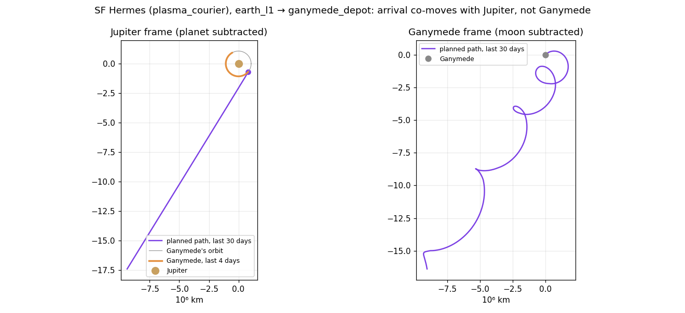

# Wobbly Paths to Ganymede and Titan: Diagnosis and Fix Plan

Status: the heliocentric wobble is fixed in the drawing (2026-10-11, see "Revisited" below). F1 and F2 are not
implemented.

Reported by the user (2026-10-09, `docs/roadmap.md`): drawn trajectories of ships flying to Ganymede and Titan show
wobbles, as if computed or drawn in the moon's frame without subtracting the moon's motion around its planet.

## Revisited: the wobble is in the heliocentric frame (fixed)

The user clarified that the mild wobble shows in the heliocentric frame, not in the moon's. The path samples there
are smooth: residuals from a smoothing spline are ≤ 0.0003 AU. The wobble came from **drawing between the
samples**:
- `_helio_point_m` interpolated radius and angle *linearly* in time.
- On the long, nearly radial stretches of outer-system flights, samples are up to 0.4 AU apart. A linear r/θ
  interpolation bows such a stretch sideways and leaves a corner at every sample.

Measured over 155 interplanetary paths (snapshots on days 120-720), as the drawn line's distance from a smooth
cubic spline through the same samples:

| Drawing | Worst path | 90th percentile |
|---|---|---|
| Linear r/θ (before) | 0.031 AU | 0.005 AU |
| Cubic Hermite r/θ (now) | 0.005 AU | 0.001 AU |

Of the 25 worst paths, 23 went to or from Ganymede, Titan or Luna, which is why it looked like a moon problem:
outer-moon routes are the long ones with near-radial legs.

**Fix (Godot only):** `Main.gd` `_cache_helio_polar` stores each sample's radius, unwound angle and their rates.
The rates are time-weighted central differences, taken from samples within the flight only, so wait samples
before departure don't bend the start. `_helio_point_m` interpolates with a cubic Hermite. The line still passes
exactly through every sample and is now smooth at each one. ShotTour gained `--shot-moon-paths`: up to four
moon-bound ships at three zooms.

What follows is the first diagnosis. It is still true but a separate issue: it shows only in a frame that
follows the moon.

## Findings (first diagnosis: the moon's frame)

Evidence comes from headless snapshots (`--snapshot-json`, days 120-720), a bridge snapshot at day 124, a Python
port of the Godot rail-drawing code, and ShotTour screenshots. The scripts were scratch work; they are described
under "Tools" below.

### What is fine

- Every path sample is heliocentric. No sample mixes a moon-relative position with a heliocentric one.
- The endpoint snap is small: the audit's start and endpoint miss checks (0.01 AU) passed with 0 flags in the
  steps 23-28 benchmarks.
- Step 25's drawing (`Main.gd` `_helio_point_m`, r/θ interpolation between heliocentric samples) is smooth. The
  Python port of `_rail_line_m` finds no kinks in the drawn transfer lines.
- In the day-124 screenshots, the orange line with a hook through Jupiter is **Jupiter's own orbit ring** in
  perspective, not a ship path. The Hohmann colour is the same orange.

### Cause 1 (the visible wobble): moon legs co-move with the planet, not the moon

Neither planner knows about the moon's motion around the planet:
- The interplanetary paths, both variable-Isp and Lambert/Hohmann, target the moon station's *position* at
  arrival (and start from it at departure).
- Their velocity there is the planet's: a heliocentric path near Jupiter moves with Jupiter.

Speed of the path's end segment relative to the moon and to the planet, from snapshots on days 120-720:

| Route end | Relative to planet | Relative to moon | Moon's orbital speed |
|---|---|---|---|
| Ganymede, variable-Isp arrivals and departures | 0.4-1.4 km/s | 9.6-12.0 km/s | 10.9 km/s |
| Ganymede, Lambert and Hohmann | 2.3-4.5 km/s | 8.2-14.0 km/s | 10.9 km/s |
| Titan, variable-Isp arrivals | 0.5-1.0 km/s | 4.7-6.1 km/s | 5.6 km/s |
| Luna, interplanetary variable-Isp | 1.0-1.8 km/s | 1.1-2.8 km/s | 1.0 km/s (mild) |
| Luna, same-system hops (`*_planet_system`) | 0-0.2 km/s | 0.8-1.0 km/s | 1.0 km/s |

So a ship meets the moon at a single point while moving at the moon's whole orbital speed relative to it, and at
docking it effectively jumps onto the moon. Seen from a camera that follows the moon or the ship near arrival,
the approach is a chain of loops at the moon's period: 7.2 days for Ganymede, 15.9 for Titan.

This matches the user's description ("as if drawn in the moon's frame without subtracting its motion"), in
reverse: the path is right in the planet's frame and wobbly in the moon's. Luna shows the same effect, but Earth's
Moon is slow (1 km/s, 27 days), so it barely shows.

### Cause 2 (latent): wait samples at moon stations alias

`prepend_wait_samples` (`src/trajectory/TrajectoryPlanner.cpp:98-135`) places one Kepler wait sample per 5° of the
*planet's* heliocentric sweep, with at least 11. That is 60 days at Jupiter and 149 at Saturn, or shorter for
short waits; for example, one Titan wait had 11 samples 8.85 days apart. The samples land on the moon station's
true position, so consecutive samples jump by:
- about 85° (Ganymede) or 200° (Titan) of the moon's orbit;
- that is a ±0.007-0.008 AU zigzag along the planet's track.

Today this is invisible:
- Godot draws only departure to arrival (`_rail_line_m`).
- Godot puts a waiting ship at its station (`_ship_m`).

But the samples are wrong data. The C++ render position (`get_ship_render_position`) and any future drawing of the
wait would zigzag, and the audit's `coarse_wait` check (heliocentric angle only) misses it.

## Proposed Fix

### F1: an in-system leg at moon stations (the physics; lower priority now that the visible wobble is fixed)

Split every interplanetary leg that starts or ends at a moon station into:

1. **The interplanetary part**, to or from a *capture point*: the planet's position plus the moon station's offset
   at the moment of capture. It co-moves with the planet, which is what the planners already produce. For
   variable-Isp, only the target changes (`station_target`, `VariableIspTrajectoryPlanner.cpp:440-448`). For
   Lambert, use the planet position plus that offset in r1/r2. So the first change is small.
2. **A local leg** in the planet's frame, from the capture point to the moon station (or back), using the existing
   `planet_system_path` machinery (`TrajectoryPlanner.cpp:247-295`), which already builds samples as "planet
   position(t) + ellipse point". It needs one change: a start (or finish) given as a planet-relative point and
   time instead of a station. Duration: half the moon's period (an in-system half-ellipse, 3.6 days at Ganymede
   and 8 days at Titan), added to the trip time.
3. **Path data:** mark the local legs. Add `local_from_s` and `local_until_s`, or a per-sample frame tag, to
   `TrajectoryPlan` and to the bridge path JSON.
4. **Godot:** inside a local window, draw with the planet as anchor, using the same blended-anchor rail as
   same-system hops (`_rail_anchor_m`, non-helio branch). Outside it, keep step 25's heliocentric drawing. The
   join is continuous, because both parts meet at the capture point, which co-moves with the planet.

Cost and economy (**decision for the user**):
- (a) **Time only (recommended first):** the local leg adds time but no propellant. The economy changes by a few
  days per outer-system trip; check with `tools/benchmark.py`.
- (b) **Charge the moon's Δv:** charge it like the existing same-system hops. Matching Ganymede's 10.9 km/s is a
  large bill for nuclear-thermal ships and would change outer-system economics, so it is better decided together
  with the roadmap's "patched-conic SOI handoffs" phase. F1 is the lightweight first step of that phase.

### F2: wait samples at moon stations

During the wait, sample the *planet's* rail plus the station's offset at the departure moment:
`planet(t) + (station(departure) - planet(departure))`.
- The last sample is exactly the station at departure, as now.
- The sample count stays at 5° of the planet's sweep.

Alternative: sample at 1/12 of the moon's period, but a 1,800-day wait at Ganymede would then need about 3,000
samples. F2 keeps the data small and smooth, and a waiting ship is drawn at its station anyway.

### F3: rendering fallback (only if F1 is postponed)

In Godot, within a few moon periods of arrival or departure, blend the anchor from the planet to the moon with a
smoothstep. This hides the loops without touching the simulation, but the 11 km/s jump stays in the physics. Not
recommended on its own.

## Audit Checks (`--trajectory-audit`, `src/trajectory/TrajectoryAudit.{hpp,cpp}`)

- `moon_rendezvous`: at a moon-station endpoint, the end segment's speed relative to the station's body is over
  2 km/s.
  - Computed over the last (or first) 0.5 days of the path, interpolated, so sample spacing doesn't matter.
  - Today it would flag every Ganymede and Titan leg. After F1 it should flag none.
- `moon_alias`: between consecutive wait samples, the station's angle around its parent planet changes by more
  than 30°. Today it would flag every Kepler wait at Ganymede or Titan; after F2, none.
- The summary prints both counts. Thresholds go in `TrajectoryAudit.hpp` next to the others.

## Regression Tests (`tests/test_main.cpp`, next to the moon-route tests at 197-249 and 529-552)

1. Earth L1 → Ganymede (variable-Isp, Plasma Courier) and Earth L1 → Titan (Kepler):
   - the end segment's relative speed to the moon is under 2 km/s;
   - the path's last sample equals the station;
   - the local window is marked;
   - there is no `moon_rendezvous` audit flag.
2. Ganymede → Earth: the same at the start.
3. Kepler departure from Titan with a long wait: every wait sample is within 1 km of
   `planet(t) + offset(departure)`, and there is no `moon_alias` flag.
4. Synthetic audit paths, like the existing ones at 481-527: a path that meets a moon at its orbital speed is
   flagged; a co-moving one is not.

## Tools

The scratch analysis scripts should become `tools/moon_path_frames.py` when F1 is implemented:
- relative speed at each end;
- the samples in planet and moon frames;
- a port of Godot's `_rail_line_m`;
- the frame plot above.

Run them on `spacetrains_headless . --days N --snapshot-json out.json`, which also writes `out.json.paths`.

## Order and Effort

1. F2 plus the `moon_alias` check plus test 3: small, about an hour.
2. F1 with option (a), plus `moon_rendezvous`, tests 1, 2 and 4, and the Godot local-window drawing: about half
   a day. Then run the benchmark (4 starts) and the trajectory audit.
3. Option (b), the Δv of moon legs: with the patched-conic phase.
